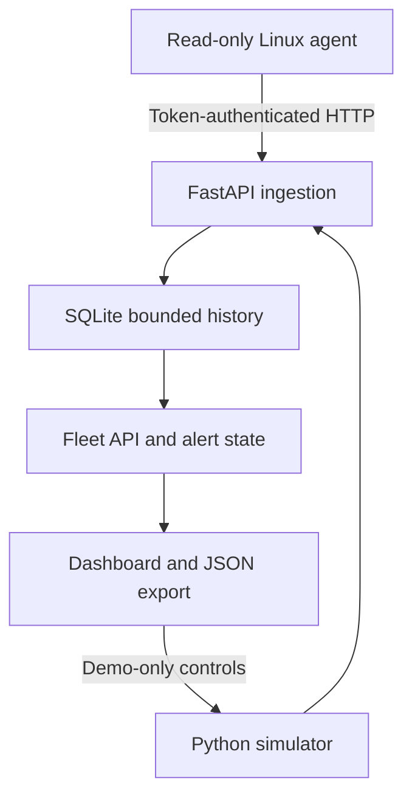

# EdgePulse — Edge Systems Lab

[](https://github.com/Davorin51/edgepulse/actions/workflows/tests.yml)

A local-first telemetry and fault-injection lab: native Linux measurements, a FastAPI/SQLite
backend, and an interactive browser dashboard. Run it without a board, then connect a Linux
agent when hardware is available. Original source; no employer/university code or paid model APIs.

## Three explicit modes

- **Hosted browser demo:** synthetic, deterministic-model telemetry; no physical board connected.
  Heat and link controls change simulated nodes. A page reload resets this browser-only session.
- **Local backend demo:** the Python server generates simulated samples and retains bounded history
  in SQLite. Browser controls only affect built-in demo nodes.
- **Measured Linux agent:** CPU usage from /proc counter deltas, available/total memory, uptime,
  and an optional thermal-zone temperature. No GPU, inference FPS or FPGA metrics are invented.

Raspberry Pi and Jetson are intended Linux deployment targets, not boards tested in this environment.
The hosted static Site does not receive your private telemetry. Run the included backend locally.

## Start locally (Python 3.11+)

```bash
python -m venv .venv
source .venv/bin/activate
pip install -e '.[dev]'
python -m edgepulse.server
```

On Windows activate `.venv\Scripts\Activate.ps1`; the server/demo works there, while the measurement
agent requires Linux /proc. Open http://127.0.0.1:8000 in your browser. Keep the `dist/` directory
beside the source package: it contains the dashboard served by the backend.

## Connect an agent

Generate a token with `python -c "import secrets; print(secrets.token_urlsafe(32))"` and set the same
`EDGEPULSE_TOKEN` environment variable on backend and agent. Ingestion is disabled for short/missing
tokens. Don't commit the token. Default server binding is loopback; opt into a trusted LAN with
`EDGEPULSE_HOST=0.0.0.0`, configure the firewall, and use TLS/authenticated access outside that lab.

```bash
# On the Linux device, after installing the package:
edgepulse-agent --url http://YOUR-LAB-HOST:8000 \
  --id my-edge --name 'My edge device' --platform Linux
```

Use `--samples 5` for five collection attempts, including collection failures and deferred sends. An unavailable temperature remains null rather than a fake
zero. The first CPU sample is computed from actual elapsed counter deltas. A thermal zone's physical
meaning depends on the board; it is not automatically asserted to be GPU or CPU junction temperature.

## Agent delivery and recovery

```bash
edgepulse-agent --url http://YOUR-LAB-HOST:8000 \
  --id my-edge --name 'My edge device' \
  --interval 3 --timeout 5 --retry-base 2 --retry-max 60
```

Network failures, socket timeouts, HTTP 408/429 and 5xx responses trigger exponential backoff
(2, 4, 8 seconds, capped at 60 by default). Delays use a monotonic clock and start after the
request finishes; the next send happens on a collection tick after that delay. `--timeout` is
the socket operation timeout, not a hard deadline for the whole process. Requests are synchronous,
so a slow request also delays the next collection.

**Latest measurements only:** failed and deferred samples are discarded, with their count logged.
There is no disk queue or historical replay. After reconnection the next attempt sends a fresh
measurement, preventing stale replay from reviving an offline device. This prioritizes current
fleet state over lossless historical collection. Delivery is not exactly-once: a lost acknowledgement
can leave an accepted sample counted as discarded by the agent.

Other HTTP errors (including authentication failures), redirects and invalid acknowledgements stop
the agent. Redirects are never followed with the bearer token. Fix the URL/token before restarting.
A successful send requires HTTP 202 and `{"accepted": true}`; a generic HTML success page is rejected.

The agent emits one JSON line per attempt: `delivered`, `retry_scheduled`, `backoff`,
`collection_error`, `no_cpu_delta` or `fatal`. Delivery lines include `discarded_samples`,
`retry_in` (seconds) and a sanitized `error` category. Counts reset after a successful delivery.
Tokens, response bodies and raw network exceptions are excluded from these runtime logs.
Exit codes: 0 for a completed bounded run with at least one acknowledged send, 1 for a fatal
transport failure or a bounded run with no acknowledgements, 2 for invalid arguments, 130 for
keyboard interruption. A 0 exit does not mean every measurement was delivered.

## Fault lab

- Heat: forces a simulated node's temperature to 88°C; alert threshold is 80°C.
- Link pause: stops simulated telemetry. The node becomes offline after 12 seconds without a sample.
- Normal: resumes synthetic samples and normal modeled temperature.
- Export snapshot: downloads the current device data with its measured/simulated mode and timestamps.

Real agents are read-only: no remote shell, reboot command, configuration upload or fault control.
Liveness uses server receive-time, not a device's potentially incorrect wall clock. CPU/memory >=90%
marks a nonthermal node busy. Each device retains at most 120 samples; intended for small labs.

## Docker

```bash
docker compose up --build
```

The published port binds to host loopback. The container runs as a non-root user, retains SQLite in
a named volume, uses no host /proc mount and never receives the Docker socket. Docker was unavailable in the authoring environment. The [first GitHub Actions run](https://github.com/Davorin51/edgepulse/actions/runs/41489569383) subsequently passed on Python 3.11 and 3.12, including Docker image build, Compose startup and the service readiness check. Physical board testing remains pending.

## Architecture



The static hosted demo uses a separate browser simulation with the same alert thresholds. It is
not a hosted Python backend. The source archive includes both the Python system and static UI.

## Real-device validation (v0.3)

Use the read-only observation tool and the step-by-step protocol in
[docs/real-device-validation.md](docs/real-device-validation.md). It records baseline,
agent interruption/offline, and reconnection/recovery as separate JSON evidence files.
These checks must still be run on physical hardware; CI only validates their logic.

## Tests

```bash
ruff check .
ruff format --check .
pytest -q --cov=edgepulse
node --check dist/app.js
python -m build
```

Tests cover token rejection, malformed metrics, null temperature, status thresholds, reserved IDs,
mode separation, SQLite persistence/retention, scoped fault controls, retry/backoff, fresh-sample
recovery, credential redirect protection, HTTP acknowledgement checks and bounded agent runs.
See docs/verification.md for executed results and remaining limits.

## Scope and next milestones

This is a single-owner lab prototype, not an Internet-facing management service. Dashboard reads
are unauthenticated; protect access before storing real device telemetry on a shared network.
SQLite device IDs are not a full enrollment/ownership system. The shared token authenticates
write access but is not per-device cryptographic attestation. No OTA update or arbitrary commands.

Next: board validation on Raspberry Pi/Jetson, device enrollment and scoped read authentication,
TLS provisioning, an explicitly timestamped historical ingestion path if lossless buffering is needed,
UI end-to-end automation, then optional Jetson-specific
GPU collectors. An FPGA UART/AXI-counter adapter is a future integration, not implemented hardware.
